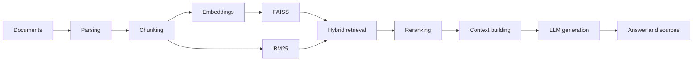
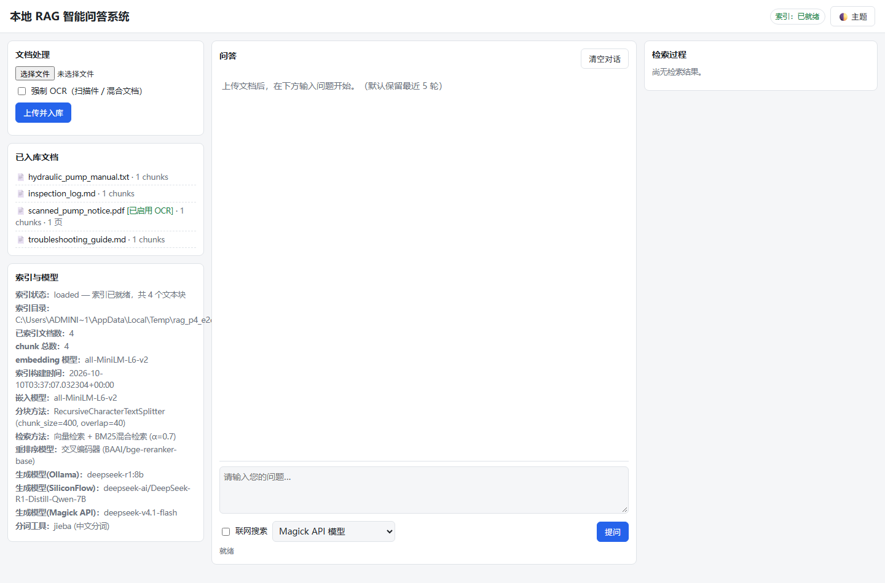
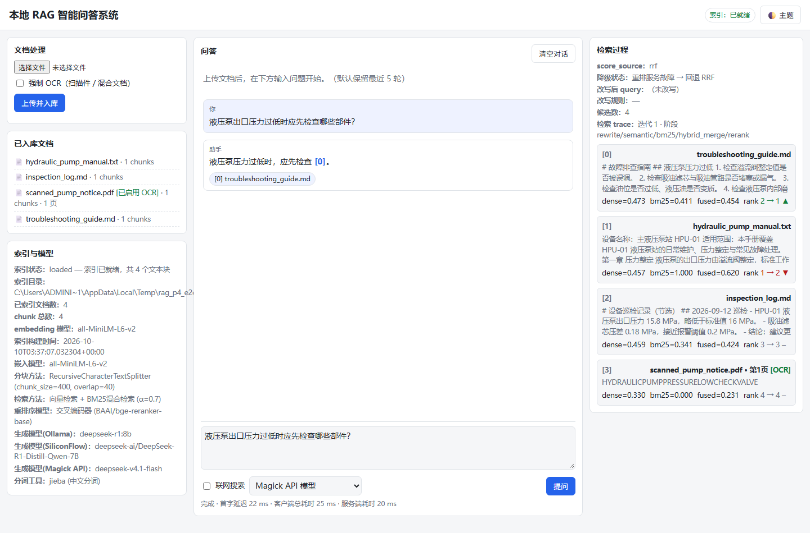
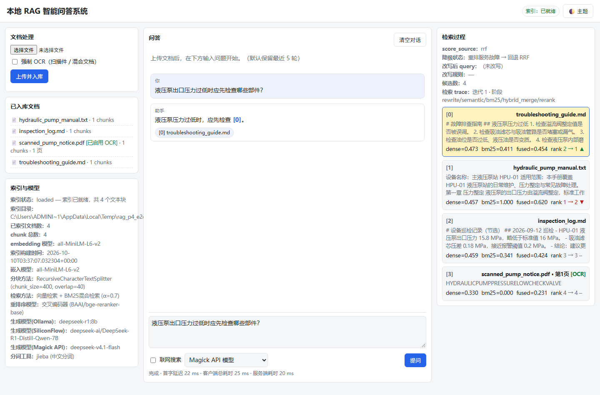
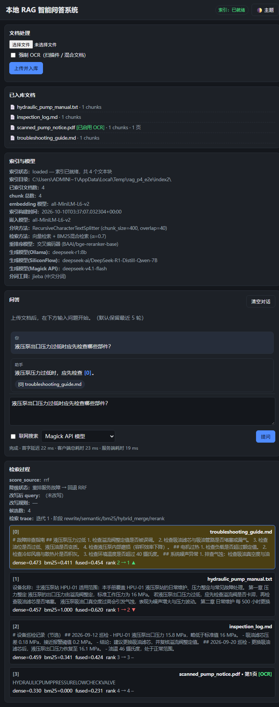

<div align="center">

# Local PDF Chat RAG

A transparent, runnable Python implementation for learning and inspecting RAG

English | [简体中文](README.zh-CN.md)

[](LICENSE)
[](https://www.python.org/)

</div>

Local PDF Chat RAG is an educational and reference implementation for developers who want to inspect the complete retrieval-augmented generation pipeline. Document loading, chunking, embeddings, FAISS, BM25, hybrid retrieval, reranking, and answer generation are split into readable and replaceable modules. The repository ships a hand-written native single page served directly by FastAPI (no frontend framework, no build step) plus a REST API.

> This repository is intended for learning and experimentation. It is not a production-ready knowledge-base service. Add authentication, tenant isolation, persistence, evaluation, security controls, and deployment governance before using it with real business data.

## Fork and modification notice

This repository is a **fork** of [`weiwill88/Local_Pdf_Chat_RAG`](https://github.com/weiwill88/Local_Pdf_Chat_RAG). The upstream project is a teaching-oriented reference implementation; its original code remains credited to the upstream author.

Planned changes in this fork (**checked items are implemented; everything else is not yet implemented**):

- [x] Repair the ineffective reranker (real CrossEncoder via config; visible failure and RRF fallback)
- [x] Make hybrid-retrieval scores meaningful (fuse normalized real FAISS distances)
- [x] Add scanned-PDF OCR (text-layer vs. OCR dual path)
- [x] Persist the index so it survives restarts
- [x] Implement real multi-turn conversation and true streaming (SSE)
- [x] Rewrite the frontend (FastAPI + native single page, including a retrieval-process panel)
- [ ] Build an evaluation harness (retrieval metrics and before/after comparison)

> The authoritative plan of record is the project WBS. Only the checked items above are implemented; the rest are **not yet implemented**. Per-phase acceptance records live in `docs/decisions.md` §7, `docs/p2-acceptance.md`, `docs/p3-acceptance.md`, and `docs/p4-acceptance.md`.

## Upstream project (reference)

The numbers, release history, and maintenance activity that were previously listed here describe the **upstream** project [`weiwill88/Local_Pdf_Chat_RAG`](https://github.com/weiwill88/Local_Pdf_Chat_RAG), not this fork, and were dated snapshots. For current upstream data, see the upstream [repository](https://github.com/weiwill88/Local_Pdf_Chat_RAG), [Actions](https://github.com/weiwill88/Local_Pdf_Chat_RAG/actions), and [Releases](https://github.com/weiwill88/Local_Pdf_Chat_RAG/releases).

## Why this project

- **Inspectable pipeline**: core modules follow the order in which a RAG request is processed.
- **Hybrid retrieval**: combines FAISS dense retrieval with BM25 keyword retrieval; the semantic score is derived from normalized real FAISS distances (`sim(d)=1/(1+max(d,0))`) rather than from rank position.
- **Reranking**: uses a real CrossEncoder whose model name comes from `config.RERANK_MODEL_NAME` (default `BAAI/bge-reranker-base`). Reranking failures are no longer silent: when the reranker is unavailable (or disabled via `RERANK_METHOD=none`), the request degrades to RRF fusion and the outcome is exposed through `score_source`/status fields and logs. See `docs/baseline-defects.md` D1 (fixed) and `docs/decisions.md` §7. Known limitation: the default model has not yet been load-verified in this environment.
- **Multiple model backends**: local Ollama, SiliconFlow, and OpenAI-compatible APIs.
- **Document support**: PDF, TXT, Markdown, DOCX, XLS/XLSX, and PPTX.
- **Single page + REST API**: FastAPI serves a hand-written native single page (no React/Vue, no build chain) and exposes a REST API.
- **Verifiable maintenance**: automated tests, GitHub Actions CI, contribution guidance, and a security-reporting process.

## RAG pipeline



## Interface preview

Upload and document list (left), streaming answer with citations (middle), retrieval-process panel (right):



Citation markers in the answer are clickable and jump to the matching chunk in the retrieval-process panel:



The retrieval-process panel shows each candidate chunk's dense/bm25/fused scores, its rank before/after the rerank (or RRF-fallback) reordering, and the `score_source` fallback state (shown here with reference `[0]` located):



Dark theme and the stacked layout at 768px:



## Quick start

### 1. Create an environment

```bash
git clone https://github.com/weiwill88/Local_Pdf_Chat_RAG.git
cd Local_Pdf_Chat_RAG

python3.10 -m venv .venv
source .venv/bin/activate  # Windows: .venv\Scripts\activate
python -m pip install --upgrade pip
pip install -r requirements.txt
```

### 2. Configure one model backend

```bash
cp example.env .env
```

Edit `.env` and choose at least one option:

- set `SILICONFLOW_API_KEY`;
- set `MAGICK_API_KEY`, its endpoint, and model name; or
- start Ollama locally and pull the model configured in `.env`.

Keep real credentials in your local `.env` file. Values beginning with `Your_` are treated as placeholders and are not valid credentials.

### 3. Start the UI and API (single service)

```bash
python api_router.py
```

Open `http://127.0.0.1:17995/` for the UI. Static assets (`web/`) are served directly by FastAPI, with no frontend build step. The service first tries `http://127.0.0.1:17995`, then ports 17996–17999 if needed.

Main endpoints:

- `GET /api/status`: runtime state, three-state index status, and model configuration;
- `GET /api/documents`: indexed documents (source, chunk count, OCR flag, page count);
- `POST /api/upload`: upload and process documents (multiple files; `force_ocr` switch);
- `POST /api/ask`: ask a question against processed documents (non-streaming, kept compatible);
- `POST /api/ask/stream`: streaming (SSE) Q&A with the event order `retrieval → delta* → citation → done`.

## Repository layout

```text
├── config.py                  # Environment, model, and RAG settings
├── web/                       # Native single page (index.html / app.css / app.js, no framework)
├── api_router.py              # FastAPI interface
├── core/
│   ├── document_loader.py     # Document extraction
│   ├── text_splitter.py       # Text chunking
│   ├── embeddings.py          # Embeddings
│   ├── vector_store.py        # FAISS index
│   ├── bm25_index.py          # BM25 index
│   ├── retriever.py           # Hybrid and recursive retrieval
│   ├── reranker.py            # Result reranking
│   └── generator.py           # Context and answer generation
├── features/                  # Web search and optional extensions
├── tests/                     # Tests that require no external credentials
└── .github/                   # CI, issue forms, and pull request template
```

## Tests

```bash
pip install -r requirements-dev.txt
PYTEST_DISABLE_PLUGIN_AUTOLOAD=1 python -m pytest
```

The current suite covers:

- configuration and default backend selection;
- TXT, Markdown, and unsupported-file loading behavior;
- BM25 and hybrid-result merging;
- clean, network-free failure when an API key is missing.

GitHub Actions compiles the Python sources and runs the test suite for every pull request.

## Configuration

See [`example.env`](example.env) for the complete example. Common variables include:

| Variable | Purpose |
| --- | --- |
| `SILICONFLOW_API_KEY` | SiliconFlow API credential |
| `SILICONFLOW_MODEL_NAME` | SiliconFlow model ID |
| `MAGICK_API_KEY` | OpenAI-compatible provider credential |
| `MAGICK_API_URL` | Provider base URL or full Chat Completions URL |
| `MAGICK_MODEL_NAME` | Provider model ID |
| `OLLAMA_MODEL_NAME` | Local Ollama model name |
| `SERPAPI_KEY` | Optional web-search credential |
| `RERANK_METHOD` | `cross_encoder` or `llm` |

## Known limitations

- PDF extraction reads the text layer and does not provide general-purpose OCR.
- Excel and PowerPoint extraction focuses on text rather than visual layout.
- The index is currently in process memory and must be rebuilt after restart.
- Embedding and reranking models may be downloaded on first use.
- Cloud model and web-search requests send the relevant query to third-party services; review your data boundary first.

## Contributing

Reproducible bug reports, documentation improvements, and focused pull requests are welcome. Read [`CONTRIBUTING.md`](CONTRIBUTING.md) and [`CODE_OF_CONDUCT.md`](CODE_OF_CONDUCT.md) before contributing.

Do not open a public issue for a vulnerability. Follow [`SECURITY.md`](SECURITY.md) instead.

## Releases and maintenance

- Changelog: [`CHANGELOG.md`](CHANGELOG.md)
- Upstream releases: [GitHub Releases](https://github.com/weiwill88/Local_Pdf_Chat_RAG/releases) (upstream `weiwill88/Local_Pdf_Chat_RAG`; this fork has no releases yet)
- Upstream maintainer: [Will Wei](https://github.com/weiwill88)

## License

Released under the [MIT License](LICENSE).
